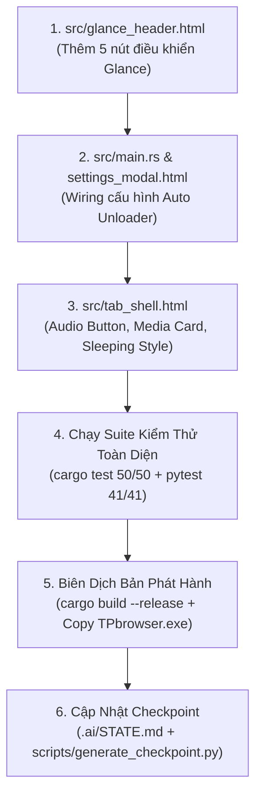

# Đợt 3 — Handoff Kế Thừa Tính Năng (Auto Unload, Zen Glance, Media Control, Link Pill)

> **Ghi chú bắt buộc:** Đọc kĩ `AGENTS.md`, `.ai/STATE.md`, `.ai/checkpoints/PROJECT_STATE.json` trước khi chỉnh sửa.
> Tài liệu này mô tả chi tiết trạng thái mã nguồn Đợt 3, các điểm neo code (search patterns, function names, line numbers), ràng buộc kiến trúc và các bước cần thực thi tiếp theo.

---

## 1. Trạng Thái Build & Test Hiện Tại

| Hạng mục kiểm tra | Trạng thái | Ghi chú chi tiết |
|---|---|---|
| `cargo test` | **50/50 PASS (100%)** | 0 error, 0 warning logic (compile sạch sẽ). |
| Pytest Contract Tests | **41/41 PASS (100%)** | Chạy qua venv Hermes: `tests/test_checkpoint_integrity.py`, `tests/test_titlebar_split_contract.py`, `tests/test_webview_ecom_scan.py`. |
| `cargo build --release` | **CHƯA REBUILD** | File `TPbrowser.exe` ở thư mục gốc repo hiện tại là artifact kết thúc Đợt 2, **chưa chứa code Đợt 3**. Cần build lại sau khi hoàn thiện UI. |
| Git Working Tree | **Chưa commit** | Đang trên nhánh `main`, các file thay đổi Đợt 3 chưa staged/committed. |

---

## 2. Ràng Buộc Bắt Buộc Giữ Nguyên (Strict Rules)

1. **Bảo toàn 100% Contract Tests**:
   - `tests/test_titlebar_split_contract.py`: Bắt buộc bảo toàn thứ tự DOM trong `src/tab_shell.html`:
     `assert tab_shell.index('id="v_pinned_section"') < tab_shell.index('id="v_tab_list"') < tab_shell.index('class="space-section') < tab_shell.index('id="v_worker_section"')`
   - Header lát cắt `tab_shell.split('id="v_tab_list"', 1)[0]` **không được chứa** các chuỗi `nav_back`, `nav_forward`, `"cmd:'reload'"`.
2. **Nguyên tắc Bảo mật DOM (`src/content_agent.js`)**:
   - **Tuyệt đối không dùng `.innerHTML`** dưới mọi hình thức (tuân thủ Trusted Types).
   - Mọi phần tử DOM động phải tạo thông qua hàm trợ năng `domEl()` hoặc Native DOM API (`document.createElement`, `textContent`, `setAttribute`).
3. **Chuẩn UI & Không dùng Checkbox Native**:
   - Không chèn input `type="checkbox"` trong HTML mới; dùng widget `.pill-switch` custom của AURELIA.
4. **Quy ước IPC và Enum trong Rust (`src/main.rs`)**:
   - Biến thể mới của `enum AppCmd` luôn thêm vào **cuối enum** để tránh làm lệch các match arm hiện tại.
   - Các case IPC mới trong `handle_ipc` chèn tại vị trí an toàn (sau case `copy_to_clipboard`).

---

## 3. Chi Tiết Từng Mục Trong 4 Tính Năng Đợt 3

### Tính Năng 1: Auto Tab Unloader (Ngủ Đông Tab Tự Động Tiết Kiệm RAM)

#### A. Đã Xong Ở Backend Rust (`src/main.rs`)
- **Cấu trúc dữ liệu `BrowserTab`** (~dòng 1743): Bổ sung `last_active_at: Instant`, `audible: bool`, `muted: bool`, `media_title: String`, `media_artist: String`.
- **Cấu hình `TpBrowserApp`** (~dòng 2550):
  * `tab_unload_minutes: u32` (mặc định 30 phút, `0` = tắt tính năng).
  * `tab_unload_whitelist: String` (mặc định `"chat.zalo.me,messenger.com,banhang.shopee.vn,seller-vn.tiktok.com"`).
  * Đã persist trong `load_config()` (~dòng 4643) và `save_config()`.
- **Lệnh điều khiển `AppCmd::UnloadTab(u64)`**:
  * Match arm trong `execute()` gọi helper `unload_tab_by_id(&mut self, tab_id)`.
  * Helper `can_auto_unload_tab(&self, idx) -> bool`: Chặn ngủ đông nếu tab đang active, đang ghép Split View, chưa load xong, là tab Bot/AI Worker, tab Essential, tab Ghim (Pinned), tab đang phát âm thanh (`audible == true`), URL hệ thống (`tp://`), hoặc domain nằm trong `tab_unload_whitelist`.
  * Cơ chế ngủ đông: `is_loaded = false`, giải phóng media info, nạp HTML placeholder "☾ Tab đang ngủ đông", gọi `set_memory_usage_level(Low)`, ẩn WebView `set_visible(false)`, đồng bộ UI qua `sync_all_ui()`.
- **Timer quét tự động**: Tích hợp trực tiếp vào vòng lặp 15s sẵn có `check_reminders()` — không spawn thread mới.
- **IPC tiếp nhận**: Case `"unload_tab"` nhận `tab_id`.
- **Payload UI**: `sync_all_ui()` đã truyền trường `"sleeping": !is_loaded` vào mảng tabs của `tab_shell`.

#### B. Còn Thiếu Ở UI & Điểm Chèn Code (Insertion Points)
1. **Bổ sung Config Payload trong `src/main.rs`**:
   - *Hàm*: `build_config_payload_json(&self, open_section: Option<&str>) -> String` (~dòng 3981).
   - *Pattern tìm kiếm*: `\"compact_mode\":{},\"view_mode\":\"{}\"`
   - *Hành động*: Bổ sung `\"tab_unload_minutes\":{},\"tab_unload_whitelist\":\"{}\",` và truyền `self.tab_unload_minutes`, `Self::escape_json(&self.tab_unload_whitelist)`.
2. **Bổ sung SaveSetting trong `src/main.rs`**:
   - *Hàm*: `execute(AppCmd::SaveSetting { key, value })` (~dòng 6954).
   - *Pattern tìm kiếm*: `"compact_mode" => {`
   - *Hành động*: Thêm 2 nhánh:
     ```rust
     "tab_unload_minutes" => {
         if let Ok(m) = value.trim().parse::<u32>() {
             self.tab_unload_minutes = m.min(600);
         }
     }
     "tab_unload_whitelist" => {
         self.tab_unload_whitelist = value.trim().to_string();
     }
     ```
3. **Hiển thị giao diện tab ngủ đông trong `src/tab_shell.html`**:
   - *CSS*: Thêm vào khối style:
     ```css
     .v-tab-item.sleeping { opacity: 0.45; filter: grayscale(0.35); }
     ```
   - *Hàm JS*: `renderVerticalTab(t, isAct, iconOnly)` (~dòng 1229).
   - *Pattern tìm kiếm*: `row.className = "v-tab-item " + (isAct ? "active " : "") + (t.selected ? "selected " : "") + (t.group_id ? "grouped" : "");`
   - *Hành động*: Nối thêm `(t.sleeping ? "sleeping " : "")`.
4. **Thêm thao tác vào Context Menu trong `src/tab_shell.html`**:
   - *Hàm JS*: `openTabContextMenu(x, y, tab, isAct)` (~dòng 1105).
   - *Pattern tìm kiếm*: `addItem(tab.essential ? "☆ Gỡ khỏi Essentials"` (~dòng 1126).
   - *Hành động*: Thêm mục menu:
     ```javascript
     if (!tab.sleeping && !isAct && !tab.worker_kind) {
       addItem("☾ Cho Tab ngủ đông ngay", function() {
         sendRust({ cmd: "unload_tab", tab_id: tab.id });
       });
     }
     ```
5. **Thêm UI cấu hình trong `src/settings_modal.html`**:
   - *Vị trí HTML*: Thẻ `#pane_tabs` (~dòng 726, ngay dưới switch `compact_mode`).
   - *Hành động*: Thêm hàng nhập số phút và danh sách whitelist.
   - *Vị trí JS*: `__tpSyncSettingsModal` (~dòng 1315) để bind dữ liệu khi mở modal.

---

### Tính Năng 2: Zen Glance Nâng Cao (Navigation Controls & Split View)

#### A. Đã Xong Ở Backend Rust (`src/main.rs`)
- **Lệnh điều khiển `AppCmd`**: `GlanceOpenInSplit`, `GlanceNavBack`, `GlanceNavForward`, `GlanceReload`, `GlanceCopyUrl`.
- **Xử lý Native trong `execute()`**:
  * Điều khiển WebView glance: `glance_body_shell.with_webview(|wv| wv.go_back())`, `go_forward()`, `reload()`.
  * `GlanceCopyUrl`: Lấy `self.glance_url`, ghi vào Win32 Clipboard qua `arboard::Clipboard`.
  * `GlanceOpenInSplit`: Đóng Glance (`AppCmd::CloseGlance`) và mở URL vào khung chia (`AppCmd::OpenInSplit(url)`).
- **IPC Dispatch**: Case `"glance_open_in_split"`, `"glance_nav_back"`, `"glance_nav_forward"`, `"glance_reload"`, `"glance_copy_url"` đã map đầy đủ.

#### B. Còn Thiếu Ở UI & Điểm Chèn Code
- **File cần chỉnh sửa**: `src/glance_header.html`.
- *Pattern tìm kiếm*: `<div class="gl-actions">` (~dòng 111).
- *Cấu trúc hiện tại*:
  ```html
  <div class="gl-actions">
    <span class="gl-esc-hint">ESC để đóng</span>
    <button type="button" class="gl-ico-btn" onclick="sendRust({cmd:'glance_open_in_tab'})" title="Mở ra Tab lớn">...</button>
    <button type="button" class="gl-ico-btn" onclick="sendRust({cmd:'close_glance'})" title="Đóng (ESC)">...</button>
  </div>
  ```
- *Hành động*: Chèn 5 nút SVG trước nút `glance_open_in_tab`:
  1. `Quay lại` (`glance_nav_back`) với icon mũi tên trái `←`.
  2. `Tiến tới` (`glance_nav_forward`) với icon mũi tên phải `→`.
  3. `Tải lại` (`glance_reload`) với icon xoay vòng `↻`.
  4. `Sao chép URL` (`glance_copy_url`) với icon copy/clipboard.
  5. `Mở trong Split View` (`glance_open_in_split`) với icon chia cột `◫`.

---

### Tính Năng 3: Audio/Mute Indicator & Mini Media Player

#### A. Đã Xong Ở Backend Rust & Content Agent
- **Thu thập trạng thái media (`src/content_agent.js`)**:
  * Cuối file: Hàm `reportMediaState()` quét toàn bộ thẻ `<video>`, `<audio>` và `navigator.mediaSession.metadata`.
  * Polling chu kỳ 1.2s, so sánh signature `lastMediaSig` để chỉ bắn IPC `"cmd":"tab_media_state"` khi có thay đổi thực tế.
  * Nhận hook native: `window.__tpSetTabMuted(mute)` (bật/tắt thuộc tính `.muted`), `window.__tpMediaControl(action)` (xử lý `toggle_play`, `next`, `prev`, `pip`).
- **Xử lý Native trong `src/main.rs`**:
  * `AppCmd::UpdateTabMedia { tab_id, playing, muted, title, artist }`: Cập nhật metadata cho tab.
  * `AppCmd::ToggleTabMute(u64)`: Đảo trạng thái mute và gửi script sang webview của tab.
  * `AppCmd::MediaControl { tab_id, action }`: Chuyển tiếp action xuống tab đang phát.
  * `sync_all_ui()`: Đã truyền `audible`, `muted`, `media_title`, `media_artist` sang shell.

#### B. Còn Thiếu Ở UI & Điểm Chèn Code (`src/tab_shell.html`)
1. **Nút Audio Indicator trên từng Tab Dọc**:
   - *Hàm JS*: `renderVerticalTab(t, isAct, iconOnly)` (~dòng 1340).
   - *Pattern tìm kiếm*: `if (!iconOnly) { var cls = document.createElement("button");` (~dòng 1340).
   - *Hành động*: Thêm nút audio nếu `t.audible`:
     ```javascript
     if (!iconOnly && t.audible) {
       var audBtn = document.createElement("button");
       audBtn.type = "button";
       audBtn.className = "tab-audio-btn hide-when-collapsed";
       audBtn.title = t.muted ? "Bật tiếng Tab" : "Tắt tiếng Tab";
       audBtn.textContent = t.muted ? "🔇" : "🔊";
       audBtn.onclick = function(ev) {
         ev.stopPropagation();
         sendRust({ cmd: "toggle_tab_mute", tab_id: t.id });
       };
       row.appendChild(audBtn);
     }
     ```
2. **Tùy chọn Mute/Unmute trong Tab Context Menu**:
   - *Hàm JS*: `openTabContextMenu(x, y, tab, isAct)` (~dòng 1128).
   - *Pattern tìm kiếm*: `addItem("Nhân đôi Tab", function() {`
   - *Hành động*: Chèn thêm:
     ```javascript
     addItem(tab.muted ? "🔊 Bật tiếng Tab" : "🔇 Tắt tiếng Tab", function() {
       sendRust({ cmd: "toggle_tab_mute", tab_id: tab.id });
     });
     ```
3. **Thẻ Mini Media Player (`#v_media_card`)**:
   - *Vị trí HTML*: **BẮT BUỘC đặt giữa `#v_tab_list` và `.space-section`** để thỏa mãn Contract Test:
     * *Pattern tìm kiếm*:
       ```html
       <div id="v_tab_list" class="v-tab-list"></div>
       ```
     * *Chèn ngay phía dưới*:
       ```html
       <div id="v_media_card" class="v-media-card hide-when-collapsed" hidden>
         <div class="v-media-info">
           <div class="v-media-icon">🎵</div>
           <div class="v-media-text">
             <div id="v_media_title" class="v-media-title">Chưa phát nhạc</div>
             <div id="v_media_artist" class="v-media-artist">TPbrowser</div>
           </div>
           <button type="button" class="v-media-btn" id="v_media_focus_btn" title="Chuyển tới Tab">⧉</button>
         </div>
         <div class="v-media-controls">
           <button type="button" class="v-media-btn" id="v_media_prev_btn" title="Bài trước">⏮</button>
           <button type="button" class="v-media-btn cta" id="v_media_play_btn" title="Phát / Tạm dừng">⏯</button>
           <button type="button" class="v-media-btn" id="v_media_next_btn" title="Bài tiếp theo">⏭</button>
           <button type="button" class="v-media-btn" id="v_media_mute_btn" title="Tắt / Bật tiếng">🔊</button>
         </div>
       </div>
       ```
4. **JS Điều Khiển Media Card**:
   - *Hàm JS*: Thêm hàm `renderMediaCard(state)` và gọi nó bên trong `__tpSyncShellState(state)` (~dòng 1186).
   - *Logic*: Lọc tab có `t.audible === true` (ưu tiên tab đang phát nhạc ngầm). Nếu tìm thấy: hiển thị card, cập nhật `media_title`, `media_artist`, bind click tương ứng gọi `sendRust({ cmd: "media_control", tab_id: targetTab.id, action: ... })`. Nếu không có tab nào audible: set `mediaCard.hidden = true`.

---

### Tính Năng 4: Floating Link Status Pill (Xem Trước URL Khi Hover)

#### A. Trạng Thái Hiện Tại
- **ĐÃ HOÀN TẤT 100% CODE**:
  * File `src/content_agent.js` đã dựng node `#__tp_link_pill` thuần DOM API (`domEl()`), gắn vào root shadow `#__tp_bubble_root`.
  * CSS định dạng: Góc trái dưới màn hình (`bottom: 10px; left: 10px`), bo tròn `999px`, nền obsidian mờ `backdrop-filter: blur(8px)`, chữ vàng gold.
  * Bắt sự kiện delegate `mouseover`/`mouseout` trên thẻ `a[href]`, chuẩn hóa link qua `new URL(href, location.href)` và tự ẩn sau 120ms khi rời chuột.
- **Việc cần làm**: Chạy ứng dụng và di chuột lên một liên kết bất kỳ trên trang web để nghiệm thu trực quan.

---

## 4. Thứ Tự Khuyến Nghị Triển Khai Tiếp Theo



1. **Bước 1 — Zen Glance Buttons**: Mở `src/glance_header.html`, chèn 5 nút icon SVG. (Rủi ro thấp nhất, không chạm Rust).
2. **Bước 2 — Auto Unloader Wiring**:
   - Thêm `tab_unload_minutes` & `tab_unload_whitelist` vào `build_config_payload_json` và match arm `SaveSetting` trong `src/main.rs`.
   - Bổ sung 2 input cài đặt vào `#pane_tabs` trong `src/settings_modal.html`.
3. **Bước 3 — Media Card & Tab Shell UI**:
   - Chèn CSS `.tab-audio-btn`, `.v-tab-item.sleeping`, `.v-media-card` vào `src/tab_shell.html`.
   - Chèn `#v_media_card` vào HTML giữa `#v_tab_list` và `.space-section`.
   - Bổ sung logic render tab audio button, menu item ngủ đông, và hàm `renderMediaCard`.
4. **Bước 4 — Kiểm thử & Build Release**:
   - Chạy toàn bộ lệnh verify dưới đây để đảm bảo không gãy bất kỳ contract nào.

---

## 5. Lệnh Verify Copy-Paste Được

### Dành cho Windows PowerShell:
```powershell
# 1. Kiểm tra biên dịch & Unit tests Rust (bắt buộc 50/50 pass)
cargo test

# 2. Kiểm tra Contract tests Python (bắt buộc 41/41 pass)
C:\Users\thien\AppData\Local\hermes\hermes-agent\venv\Scripts\python.exe -m pytest -q tests/test_checkpoint_integrity.py tests/test_titlebar_split_contract.py tests/test_webview_ecom_scan.py

# 3. Biên dịch bản Release và cập nhật file thực thi tại gốc
cargo build --release
Copy-Item -Force target/release/TPbrowser.exe ./TPbrowser.exe

# 4. Đồng bộ Checkpoint hệ thống
python scripts/generate_checkpoint.py
C:\Users\thien\AppData\Local\hermes\hermes-agent\venv\Scripts\python.exe -m pytest -q tests/test_checkpoint_integrity.py
```

### Dành cho Git Bash / MSYS2:
```bash
# 1. Kiểm tra biên dịch & Unit tests Rust
cargo test 2>&1 | tail -15

# 2. Kiểm tra Contract tests Python
/c/Users/thien/AppData/Local/hermes/hermes-agent/venv/Scripts/python.exe -m pytest -q \
  tests/test_checkpoint_integrity.py tests/test_titlebar_split_contract.py tests/test_webview_ecom_scan.py

# 3. Biên dịch Release & Copy EXE
cargo build --release
cp -f target/release/TPbrowser.exe ./TPbrowser.exe

# 4. Đồng bộ Checkpoint hệ thống
python scripts/generate_checkpoint.py
/c/Users/thien/AppData/Local/hermes/hermes-agent/venv/Scripts/python.exe -m pytest -q tests/test_checkpoint_integrity.py
```
